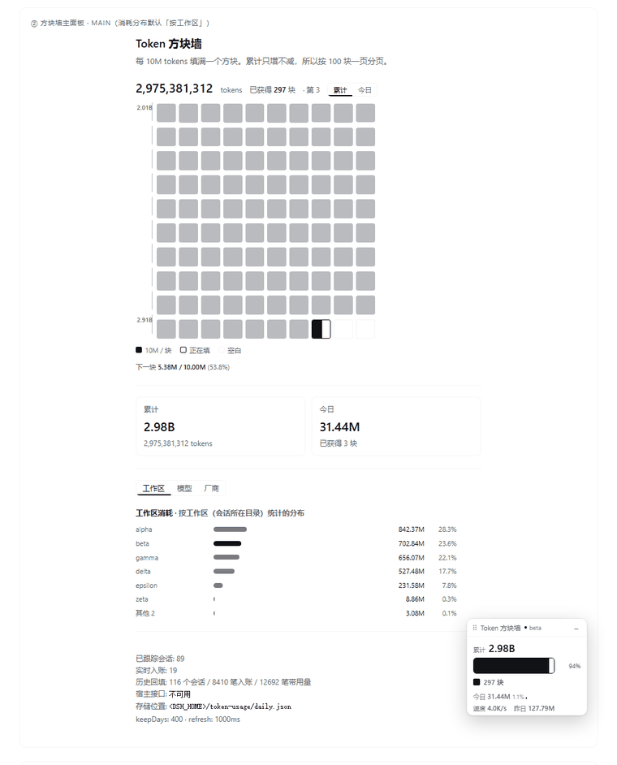
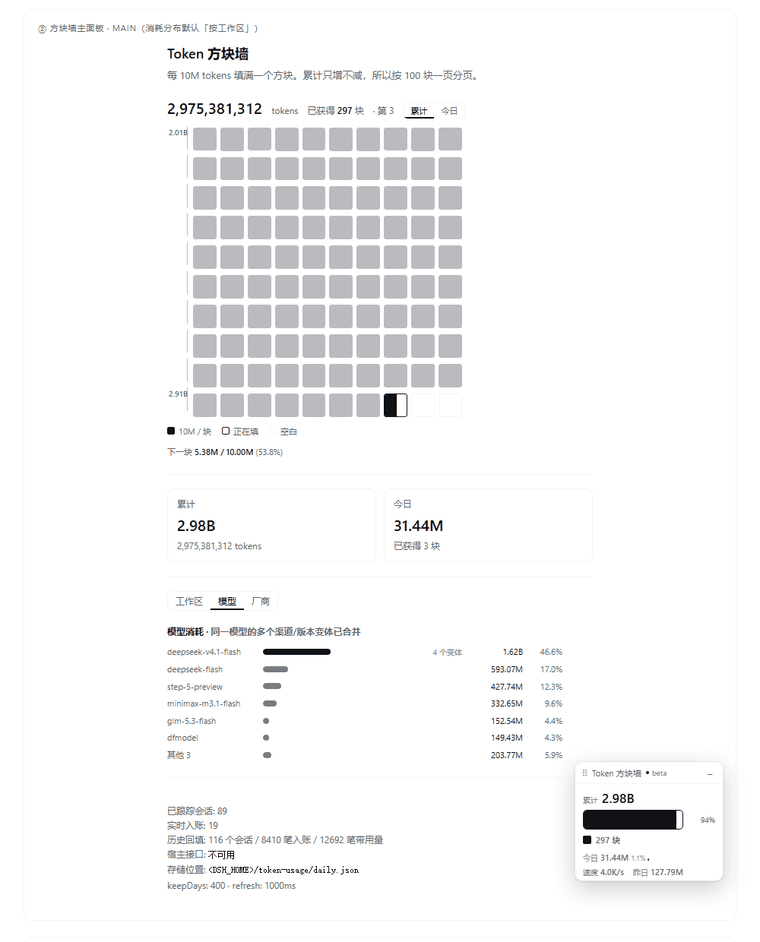

# dsh-token-wall

Token 用量看板插件，用于 DSH（DeepSeek Harness）。

按**本机时区**记录每次模型调用的 token 消耗，并把「攒了多少」做成看得见的方块墙。



- **方块墙**：每 10M tokens 填一格，100 格一页，累计只增不减
- **桌宠**：常驻角落里的小面板，本会话用量 + 上下文占用 + 全时累计块池，可拖动
- **消耗分布**：按工作区 / 模型 / 厂商三档切换
- **设置页**：区间汇总表，支持按天 / 周 / 月 / 渠道 / 模型 / 类型分组
- **历史回填**：从已有会话日志补齐历史，不是装上才开始记
- **实时捕获**：之后每次模型调用即时入账

> npm 包名是 `dsh-token-wall`（`dsh-token-usage` 已被另一个同类插件占用）。
> 插件内部的标识（路由前缀 `/dsh-token-usage`、存储目录、localStorage key）
> **都保持不变**，所以升级不会丢历史数据。

---

## 安装

本插件以 Cordis bundle 形式发布，宿主是 DSH 的 Web profile。

### 方式一：从 npm 安装（推荐）

```bash
cd ~/.dsh/profiles/<profile>
npm install dsh-token-wall
```

然后在 profile 的 `cordis.patch.yml` 里插入 bundle：

```yaml
- insert:
    - id: dsh-token-usage          # ⚠️ 用这个 id，不是包名
      name: 'dsh-token-wall'
      config:
        keepDays: 400
```

⚠️ `id` 与 `name` 不同是有意的：`id` 是插件内部标识（决定路由前缀与存储目录），
必须保持 `dsh-token-usage` 才能沿用已有数据；`name` 才是 npm 包名。

### 方式二：从源码克隆

```bash
# <profile> 通常是 ~/.dsh/profiles/<名字>
# Windows: %USERPROFILE%\.dsh\profiles\<名字>
cd ~/.dsh/profiles/<profile>/node_modules
git clone https://github.com/ChinRinhan/dsh-token-wall.git dsh-token-wall
```

### 方式三：用 DSH 的插件管理

在 DSH 会话里执行：

```
plugin_manager  install_bundle  target=dsh-token-wall
plugin_manager  set_bundle      target=dsh-token-usage  enabled=true
```

### 验证装上

启用后宿主会注册四条路由。把 `<port>` 换成你的 Web GUI 端口：

```bash
curl http://127.0.0.1:<port>/dsh-token-usage/today
```

返回 `{"ok":true,"totals":{...},"allTime":{...},...}` 就说明装好了。

界面上应该能看到三样东西：侧栏多出一个方块图标、右下角出现桌宠、设置页多出「Token 用量」一节。

### 首次启动会回填历史

`backfillOnStart`（默认开启）会扫描 `$DSH_HOME/sessions` 下的会话日志，把装上之前的用量补进来。

参考量级：本机 116 个会话、22 天、8,410 条记录，回填耗时数秒。

### 从源码安装迁移到 npm 安装

如果你之前是 clone 到 `node_modules/dsh-token-usage` 的，改成 npm 安装后要注意目录名变了
（`dsh-token-usage` → `dsh-token-wall`）：

```bash
cd ~/.dsh/profiles/<profile>
rm -rf node_modules/dsh-token-usage    # 旧目录（如果不是软链）
npm install dsh-token-wall
```

**历史数据不需要迁移**：存储路径由插件内部标识决定，与包名无关，
仍是 `$DSH_HOME/token-usage/daily.json`。

---

## 界面

### 方块墙（主面板）

点侧栏的方块图标进入。

```
总消耗 684,561,075 tokens   已获得 68 块 · 第 1 页
████ ████ ████ ████ ████ ████ ████ ████ ████ ████
████ ████ ████ ████ ████ ████ ████ ████ ████ ████
...
████ ████ ████ ████ ████ ██▓░ ░░░░ ░░░░ ░░░░ ░░░░
░░░░ ░░░░ ░░░░ ░░░░ ░░░░ ░░░░ ░░░░ ░░░░ ░░░░ ░░░░
```

- **每 10M tokens 一格**：已填 / 正在填（按比例渐进）/ 空白，三态一眼分清
- **每 10 格一道里程碑竖线**（= 1 亿 tokens），首末行标出该行的量级，看颜色密度就能判断这一段是 2 亿还是 200 亿
- **100 格一页**（= 10 亿 tokens），自动停在第 N 页
- **累计 / 今日** 可切换：累计是只增不减的历史总量，今日是午夜归零的当天量
- 页面下方是消耗分布与诊断信息

为什么是 10M：按真实数据量过，单轮对话中位 1.41M、p90 10.4M，典型活跃日 2–3 块、重度日 7–9 块。快慢都合适。

### 桌宠

常驻在窗口任意位置，也可以拖走。

```
┌─ Token 方块墙  ● alpha  ────┐
│ 本会话 119.89M              │  ← 这次对话花了多少
│ ▓▓▓▓▓░░░░░░░░░░░  30%      │  ← 当前这块 10M 填了多少
│ ■ 383 块 · 本轮 1.47M       │  ← 池（全时累计）· 本轮实时
│ 上下文 49% · 缓存 99.1% · 今日 142.59M │  ← 补充读数
└─────────────────────────────┘
```

- **本会话**：当前这个会话的用量。没有会话信息时显示 `—`（不显示 0）。
- **进度条**：当前这个 10M 方块的填充进度（`blockWall().progress`）——和池是
  同一个量纲。快攒满（≥ 90%）时轻微呼吸。
- **本轮**：进行中的这一轮，实时在涨。harness 自带的「本轮用量」只在轮次**结束
  后**才出现，这一点是它做不到的。
- **池**：全时累计块数，**不随会话变**。一个会话通常只有 0.2 块，跟随就会长期
  显示「0 块」，失去意义。
- **上下文**：`projectedTokens / contextWindow`。这是唯一**有后果**的读数——
  快满会被压缩。它是**读数而不是进度条**：60% 起转黄、85% 起转红。
- **缓存**：缓存读取 / 计费输入。这是成本的主要驱动（实测单个会话 119M 里
  118.6M 是缓存读取），而它一直只藏在详情弹窗里。
- **今日**：今天的总量，给一个节奏参照。
- **拖动**：按住标题栏拖，指针移出窗口也继续跟手
- **单击标题栏**：折叠 / 展开。折叠态只留标题栏 + 大数字 + 池，且自适应——接近
  压缩（≥ 80%）时显示上下文百分比，平时显示本会话量
- **位置记忆**：位置存在 `localStorage`，窗口缩放时自动钳制在可视范围内
- **窄屏隐藏**：≤768px 不显示（拖拽手势会和页面滚动打架）

动效很克制：上下文到 90% 以上时进度条轻微呼吸，攒到新的一块时池弹一下。系统开了「减少动态效果」时会全部关掉。

### 消耗分布

同一块区域，三个视角切换：

| 维度 | 回答的问题 |
|---|---|
| **工作区** | 我在哪个项目花得多 |
| **模型** | 我在用哪个模型花 |
| **厂商** | 我在给哪家公司送钱 |

「模型」视角会自动归并同一模型的不同写法。比如这四行其实是同一个模型：

```
deepseek-v4.1-flash             1.54B   ← 主名
workbuddy/deepseek-v4.1-flash   25.6M   ← 带渠道前缀
deepseek-ai/deepseek-v4.1-flash   52K   ← 另一种前缀
deepseek-v4.1-flash-free        23.1M   ← 带 free 后缀
```

归并后合成一行：**1.62B · 4 个变体**。



⚠️ 但**不同代际不合并**。`deepseek-flash`、`deepseek-v4-flash`、`deepseek-v4.1-flash` 是三个版本，合并会掩盖「还在用旧模型」这件事。

⚠️ 认不出厂商的模型归入「其他」，不猜。可以用配置里的 `modelAliases` 显式声明，见下。

当前在用的工作区 / 模型会高亮。

### 设置页

「Token 用量」一节包含：

- **运行时开关**（5 个，点完立即生效）：桌宠、方块墙面板、输入框上方横幅，以及两个统计口径——含子会话、含辅助调用
- 今日与累计卡片
- 区间汇总表：按天 / 周 / 月 / 工作区 / 渠道 / 模型 / 渠道+模型 / 类型分组
- 时长预设（近 7 天 / 30 天 / 90 天）+ 自定义起止日期
- 过滤开关：含子会话、含辅助调用
- 诊断区：已跟踪会话数、实时入账数、回填状态、存储位置

---

## 配置

在 profile 的 `cordis.patch.yml` 里覆盖，插件升级不会丢：

```yaml
- id: dsh-token-usage              # 内部标识，不要改（决定路由前缀与存储目录）
  name: 'dsh-token-wall'           # npm 包名
  config:
    keepDays: 400              # 保留天数（落盘时淘汰更早的日键）
    includeSubagents: true     # 计入子代理 / 团队 / workflow 子会话
    includeAuxiliary: true     # 计入压缩等辅助调用
    statusBarEnabled: true     # 是否允许显示输入框上方的横幅
    statusBarRefreshMs: 1000   # 轮询间隔，最小 1000
    backfillOnStart: true      # 启动时回填历史

    # 可选：手动声明模型别名（认不出的模型可以在这里归类）
    modelAliases:
      dfmodel:
        vendor: deepseek
        model: deepseek-v4.1-flash
```

### 开关有两层，分别管什么

| | 位置 | 生效方式 | 用途 |
|---|---|---|---|
| `config.statusBarEnabled` | `cordis.patch.yml` | 重启 DSH | 部署期的硬开关 |
| 设置页五个开关 | `$DSH_HOME/token-usage/prefs.json` | **立即生效** | 日常调整 |

设置页那五个开关存在独立文件里，是因为改 Cordis config 要重启，而「我想把桌宠关掉」显然不该重启。

其中两个是**统计口径**（`includeSub` / `includeAux`，对应「含子会话」「含辅助调用」）。它们会影响**所有**读数——方块墙、桌宠、横幅、设置页表格共用同一份口径，改完下一拍轮询就生效。放在这里而不是 Cordis config 里，是为了能随时切换并立即看到差别。

---

## HTTP 接口

启用后宿主注册四条路由，默认绑定 Web GUI 的端口。

| 路径 | 说明 |
|---|---|
| `GET /dsh-token-usage/today` | 今日 + 昨日 + 累计 + 本次运行平均速度 + 当前工作区/模型 + 运行时开关 + 诊断。接受 `includeSub` / `includeAux`，与 `/summary` **同一口径**。带 `session=<id>` 时额外下发该会话的 `session` 块（见下） |
| `GET /dsh-token-usage/summary` | 区间汇总。`groupBy` 可取 `day` `week` `month` `provider` `model` `providerModel` `kind` `workspace` `modelNorm` `vendor` |
| `GET /dsh-token-usage/workspaces` | 工作区分布，只回 top N（`limit` / `from` / `to`）。与 `/today`、`/summary` **同一口径**（运行时 prefs） |
| `GET / PUT /dsh-token-usage/prefs` | 运行时开关（`statusBar` / `pet` / `wallPanel`）。唯一可写的端点 |

`/summary` 还支持 `from` / `to` / `includeSub` / `includeAux` / `workspace` 参数。

### `?session=` 的三级降级

桌宠要显示「当前会话」，而 host 自己看不到用户在 UI 里选中了哪个会话——由客户端桥
（一个只写不画的 session-scope 组件）把 id 推上来。拿到 id 后：

| 情况 | 行为 |
|---|---|
| **活会话** | `ctx.sessions.get(id)` 命中 → `sessionProjections.snapshot()`，实时且便宜 |
| **冷会话**（重启后继续旧会话） | `sessionQuery.observeSession(id, { projectionMode: 'all' })` 从磁盘折投影 |
| **都不可用** | `projected: null` + `projectedUnavailable: <原因>`，客户端显示 `—` |

`session` 块里有两个互不重叠的来源：`live`（我们自己增量折的逐轮读数，含「本轮实时」）
与 `projected`（宿主投影的整份日志口径）。**任何一项拿不到都显示 `—`，绝不显示 0**。

---

## 数据口径

这一节讲清楚「数字是怎么算出来的」，因为它决定了你看到的数字意味着什么。

### 来源

会话日志里 `assistant/message` 事件的 `usage` 字段。**它是持久化的**，所以「历史回填」和「实时捕获」读的是同一份数据，不存在两套口径。

| 事件 | 类型 | 说明 |
|---|---|---|
| `assistant/message` | 对话调用 | 主力来源 |
| `compaction/summary` | 辅助调用 | 压缩摘要也是真实模型调用，计入 |

⚠️ 标题生成走的 `session/title-llm-request` **不带 `usage`**，因此那部分开销无法从日志恢复。这是已知限制，不是遗漏。

### 合计口径

```
totalTokens = inputTokens + cacheReadTokens + cacheWriteTokens + outputTokens
```

即「这次调用实际过了一遍的 token 总量」。它与 provider 上报的 `totalTokens`（通常只是 input+output）**不是一回事**，所以本插件不读那个字段，自己按上式算。

`outputTokens` 已含思考 token，`reasoningTokens` 只作拆分展示，不重复计入。

### 「没测到」≠「用了 0」

没带 `usage` 的调用（中断、上游提前断开、失败）**不写 0**，而是根本不入桶。覆盖率在设置页诊断区如实展示。

### 时区

按**本机时区**切日，不是 UTC。午夜归零。

### 存储位置

`$DSH_HOME/token-usage/daily.json`（日聚合）与 `$DSH_HOME/token-usage/prefs.json`（开关）。

只落日聚合、不落明细；增量合并写，多实例并存不互相覆盖；默认 2 秒防抖落盘。

更多实现细节见 [docs/DESIGN.md](docs/DESIGN.md)。

---

## 开发

```bash
npm test          # 全部不依赖本机数据的测试
npm run test:data # 需要本机会话日志：交叉校验 + 存储端到端
npm run visual    # 生成视觉验证 HTML，再用浏览器截图
npm run check     # 语法检查 + 落单反引号 + 启动标识 + 打包链接
```

> ⚠️ **改包名时**（`package.json` 的 `name`）：`client.js` 里
> `window.__ModuleLoader__.load({ id: ... })` 的 `id` **必须一起改**。宿主按包名
> 索引客户端模块，写错的后果不是「这个插件不显示」，而是**整个 Web 界面起不来**
> （`web boot: 1 entry did not activate`）。`npm run check` 会拦住这种不一致 ——
> 它跑的是 `tools/check-boot-identity.mjs`。
>
> 反过来，`index.js` 里 `export const name = 'dsh-token-usage'` 与路由前缀
> **不要**跟着包名改：它们决定 `$DSH_HOME/token-usage/` 这个存储位置，改了已有
> 用户的历史数据就找不到了。

### 测试文件

```bash
node --test test/fold.test.mjs          # 日界、周月归属、合计口径、水位线去重、fork 前缀
node --test test/blocks.test.mjs        # 方块换算：整除、跨页、当前块、进度、异常输入
node --test test/models.test.mjs        # 模型归并：归一化、代际不合并、别名
node --test test/adapter.test.mjs       # 宿主接口：新旧两代形状必须同一读数；认不出来要报 degraded
node --test test/store.retention.test.mjs # 保留期：内存与盘同时淘汰，且淘汰后不复活
node --test test/prefs.test.mjs         # 运行时开关存储：缺省、原子写、脏输入、损坏回退
node --test test/turn-fold.test.mjs     # 逐轮折叠：重试累加、同步骤替换、reasoning 不进总量、缺边界容错
node test/client.smoke.mjs              # 四个 slot 注册、会话桥、样式真进 DOM、主题 token
node test/odometer.text.mjs             # 桌宠可见文案逐条断言（含「无会话数据必须显示 —」）
node test/sparkline.test.mjs            # 上升曲线几何：左低右高、不除零
node test/blocks-cross.test.mjs         # 池内块数与 lib/blocks.js 跨端一致 + 上下文条由 contextPressure 驱动
node test/distribution.test.mjs         # 消耗分布：形状守卫、列宽预算、当前项高亮
node test/host.routes.test.mjs          # 四条路由的 JSON 契约
node --test test/host.session.test.mjs  # /today?session= 的三级降级（活会话 → 冷读 → —）
```

需要本机数据的三个（不在 `npm test` 里）：

```bash
node test/cross-validate.mjs "$DSH_HOME/sessions"   # 与独立实现交叉校验真实日志
node test/store.e2e.mjs "$DSH_HOME/sessions"        # 回填 → 落盘 → 重开 → 幂等 → 并发
node tools/cross-validate-turns.mjs "$DSH_HOME"     # 逐轮折叠 vs 宿主 tokenUsage 投影
```

### 手工验收

自动化测不到三类东西：命令式 DOM 的真实布局、宿主契约的真实形状、降级路径在真实
数据下的表现。清单见 [docs/ACCEPTANCE.md](docs/ACCEPTANCE.md)。

### 辅助工具

```bash
node tools/usage-cli.mjs --sessions "$DSH_HOME/sessions" --group-by provider
node tools/rehearse.mjs                          # 用真实 home 跑一遍完整回填
node tools/preview-blocks.mjs                    # 字符画方块墙
node tools/analyze-blocks.mjs                    # 分析「10M 一格」的填充速度
node tools/migrate-workspace.mjs --home "$DSH_HOME"   # 桶键 4 段 → 5 段（dry-run）
node tools/visual-check.mjs                      # 生成视觉验证 HTML
node tools/check-boot-identity.mjs               # 注册 id / 包名 / 发布文件一致性
node tools/check-boot-identity.mjs --profile "~/.dsh/profiles/desktop"
                                                 # 顺带扫描该 profile 里所有客户端插件
```

`tools/visual-check.mjs` 把**真实组件**装进**真实 React 18**，在浏览器里渲染（effect / fetch 全真），主题 token 从宿主的真实 CSS 里读。截图用 Windows 自带的 Edge 就行：

```bash
"/c/Program Files (x86)/Microsoft/Edge/Application/msedge.exe" \
  --headless=new --disable-gpu --hide-scrollbars --virtual-time-budget=6000 \
  --window-size=1000,1400 --screenshot=tools/out/light.png \
  "file:///$(pwd)/tools/out/visual-check.html"
```

### 改代码后怎么生效

| 改动 | 生效方式 |
|---|---|
| `client.js` | 约 500ms 内热更新（HMR 轮询文件），不用重启、不用构建 |
| `cordis.patch.yml` / `package.json` | 热重载 |
| `index.js` / `lib/**` | 禁用→重新启用该 bundle 即可，不用重启 DSH |

---

## 已知限制

- **标题生成的开销不可见**：日志里没有 `usage`，无法恢复
- **两个真实进程密集并发写**时，后写者可能基于陈旧快照覆盖。桌面场景通常单进程单 profile，影响面有限；根治需要文件锁
- **视觉验证的边界**：`tools/visual-check.mjs` 用的是真实组件 + 真实 CSS + 真实数据，但**宿主外壳是模拟的**（侧栏、设置面板外框、composer 布局）。驱动真实页面需要 launch token，没有也不该去取
- **≤768px 时桌宠隐藏**，窄屏只剩侧栏面板可用
- **保留期到期的那一天**，更早的日聚合会从盘上和内存里一起消失（默认 400 天）。这是设计行为，不是 bug；不想要就设 `keepDays: 0`

### 宿主接口兼容性

历史回填依赖 `ctx.sessionPersistence`。这个服务在不同 DSH 版本里**换过形状**：

| 能力 | 旧版 | 0.1.0-rc.6 起 |
|---|---|---|
| 列举会话 | `list()` → `{header, revision}[]` | `listSnapshots()`；`list()` 改为直接返回 `SessionHeader[]` |
| 读事件 | `open(id,'read')` → 句柄 | `load(id)` / `inspect(id)` / `readFrom(id, seq)` |
| fork 继承前缀 | `handle.inheritedEventCount` | `header.seedLength` / `session.firstLiveSeq` / `session/end-seed` 事件 |

插件通过 `lib/adapter.js` 同时支持两代。**认不出来时不会假装成功**：设置页「诊断」区会显示 `宿主接口: list=… read=…`，以及红色的「回填降级」提示——看到它就说明累计数可能偏低，请把这一行连同 DSH 版本一起反馈。

---

## 文档

- [CHANGELOG.md](CHANGELOG.md) — 版本变更：每一版修了什么、为什么、怎么验证的
- [docs/DESIGN.md](docs/DESIGN.md) — 架构与关键设计：数据流、水位线去重、fork 前缀、桶键、模型归并
- [docs/NOTES.md](docs/NOTES.md) — 开发笔记：踩过的坑、验证器失效的四种方式、视觉问题清单

## 许可证

[MIT](LICENSE)
